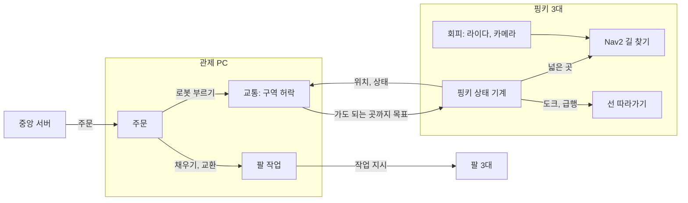

# roscamp-nav2fleet

핑키 3대가 1.98 × 0.99 m 경기장에서 바구니를 나르는 입출고 관제다. 로봇은 넓은 곳을 Nav2 goal(NavigateToPose)로 스스로 길을 짜서 다니고, 도크 진입과 긴 좁은 길(급행) 한 곳만 관제가 준 선을 FollowPath로 따라간다. 관제는 "정확히 어디로 달리나"가 아니라 "어느 구역에 들어가도 되나"를 정한다.

## 구조



| 층 | 하는 일 |
|---|---|
| 관제: 주문, 팔 | 그대로 |
| 관제: 교통 (새로) | 길 그래프(지점, 구역), 구역 허락, 목표 쪼개기, 급행 방향, 도크 줄, 막힘 처리 |
| 로봇: pinky_fsm | `mode`에 따라 Nav2 goal 또는 FollowPath. Retreat. 상태 보고 |
| 로봇: Nav2 | AMCL, bt_navigator(NavigateToPose), planner_server, controller_server(goal용 컨트롤러 하나 + FollowPath 셋) |
| 로봇: 회피 (팀원) | 라이다 + 비전 → costmap, goal용 컨트롤러 조정 |

판단(`pc/fleet_core`, `pinky/pinky_fsm/pinky_fsm/core.py`)은 ROS를 모르고, ROS 노드는 메시지만 옮긴다.

## 배치

경기장은 1.98 × 0.99 m이고 세 가지 배치를 지도로 넣었다(`pc/fleet_core/fleet_core/data/fleet_map_<배치>.yaml`). 어느 것을 쓸지는 아직 정하지 않았다. 비교표는 [작업 기록](docs/worklog_nav2base_2026-11-12.md)에 있다.

| 배치 | 모양 | 넓은 구역 | 급행(폭 0.20 m) |
|---|---|---|---|
| `d2`(기본) | 북쪽 벽을 따라 급행, 그 아래는 통째로 마당 | `HALL` 하나(3대) | 진열대 뒤, y 0.79~0.99 |
| `d` | `d2`에 가운데 진열대를 더해 마당을 서쪽, 동쪽과 그 사이 통로 둘로 나눔 | `HALL_W`, `HALL_E`(3대씩), 통로 `CORR_M`, `CORR_S`(1대씩) | `d2`와 같음 |
| `c` | 가운데에 급행, 위아래로 통로 | 네 모퉁이 마당(2대씩), 통로 `CORR_N`, `CORR_S`(1대씩) | 가운데, y 0.395~0.595 |

## 빌드와 시험 (WSL, ROS 2 Jazzy)

```bash
source /opt/ros/jazzy/setup.bash
export ROS_DOMAIN_ID=45 ROS_AUTOMATIC_DISCOVERY_RANGE=LOCALHOST   # 6은 쓰지 않는다
colcon build
source install/setup.bash
cd pc/fleet_core && python3 -m pytest -q test      # 패키지 폴더마다 같은 식
```

- 핑키 패키지는 벤더 의존(`iponic.repos`의 `pinky_pro`)이 함께 빌드되어 있어야 한다.
- `fleet_manager` 시험은 ROS 도메인 50~59를 코드에서 쓴다. 한 기계에서 한 번에 하나만 돌린다.

## 돌려 보기

```bash
# 머리 없는 세계(ROS 없음): 상황 열 가지 x 배치 x 씨드의 결과 표
python3 tools/situations.py -l d2 d c --seeds 1 2 3

# Gazebo: 핑키 3대와 관제, 배치 d2, 주문 8개
ros2 launch fleet_gz_sim gz.launch.py layout:=d2

# Gazebo: 핑키 한 대만(관제 없음), 다른 터미널에서 정해진 구간을 달리게 한다
ros2 launch fleet_gz_sim one_pinky.launch.py gui:=false rviz:=false
ros2 run fleet_gz_sim drive_check --layout d2 --plan stage2

# 실제 지도에 맞춘 keepout 마스크 만들기
python3 tools/make_keepout.py --layout d2 --map <지도.yaml>
```

Gazebo 쪽 인자와 장애물 일정은 [sim/fleet_gz_sim/README.md](sim/fleet_gz_sim/README.md)에 있다.

## 지금 상태

| 있는 것 | 아직 없는 것 |
|---|---|
| 구역 교통 층: 구역 허락, 급행 방향, 도크 줄, 막힘 처리(기다림, 표시, 돌아가기, Retreat), 교착 감시 | 실물에서의 확인: 아무것도 실물에서 재지 않았다 |
| 핑키: MoveTo `mode`(`follow_path`, `nav_goal`), Retreat, keepout 필터, 비전 장애물 자리(기본 꺼짐) | 충돌 검사를 켠 채 고정 경로 주행: Gazebo에서 통과하는 설정을 찾지 못했다 |
| 시험 환경: 머리 없는 세계(상황 열 가지), Gazebo 세 배치 | 회피(라이다와 비전으로 피하기)는 팀원 몫이고 자리만 있다 |

## 문서

| 문서 | 내용 |
|---|---|
| [docs/관제_구역교통.md](docs/관제_구역교통.md) | 교통 규칙, 사건 코드, 값 |
| [docs/회피_약속.md](docs/회피_약속.md) | 관제와 회피가 나눠 맡는 선(제안) |
| [docs/핑키_계약.md](docs/핑키_계약.md) | 핑키와 관제 사이의 계약(0.11-draft는 제안) |
| [docs/worklog_nav2base_2026-11-12.md](docs/worklog_nav2base_2026-11-12.md) | 만든 것, 측정, 가정, 남은 일 |
| [docs/COPIED_FROM.md](docs/COPIED_FROM.md) | 복사한 곳과 지운 것 |
