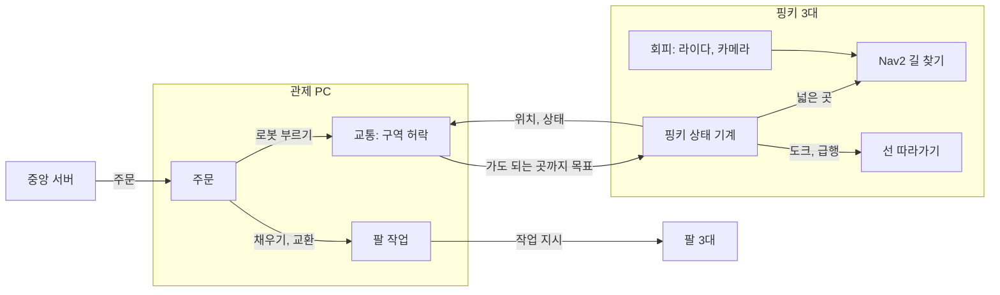

# roscamp-nav2fleet

핑키 3대가 1.98 × 0.99 m 경기장에서 바구니를 나르는 입출고 관제다. 로봇은 넓은 곳을 Nav2 goal(NavigateToPose)로 스스로 길을 짜서 다니고, 도크 진입과 긴 좁은 길(급행) 한 곳만 관제가 준 선을 FollowPath로 따라간다. 관제는 "정확히 어디로 달리나"가 아니라 "어느 구역에 들어가도 되나"를 정한다.

## 구조



| 층 | 하는 일 |
|---|---|
| 관제: 주문, 팔 | 그대로 |
| 관제: 교통 (새로) | 길 그래프(지점, 구역), 구역 허락, 목표 쪼개기, 급행 방향, 도크 줄, 막힘 처리 |
| 로봇: pinky_fsm | `mode`에 따라 Nav2 goal 또는 FollowPath. Retreat. 상태 보고 |
| 로봇: Nav2 | AMCL, bt_navigator(NavigateToPose), planner_server, controller_server(goal용 컨트롤러 하나 + FollowPath 셋) |
| 로봇: 회피 (팀원) | 라이다 + 비전 → costmap, goal용 컨트롤러 조정 |

판단(`pc/fleet_core`, `pinky/pinky_fsm/pinky_fsm/core.py`)은 ROS를 모르고, ROS 노드는 메시지만 옮긴다.

## 빌드와 시험 (WSL, ROS 2 Jazzy)

```bash
source /opt/ros/jazzy/setup.bash
export ROS_DOMAIN_ID=45 ROS_AUTOMATIC_DISCOVERY_RANGE=LOCALHOST   # 6은 쓰지 않는다
colcon build
source install/setup.bash
cd pc/fleet_core && python3 -m pytest -q test      # 패키지 폴더마다 같은 식
```

- 핑키 패키지는 벤더 의존(`iponic.repos`의 `pinky_pro`)이 함께 빌드되어 있어야 한다.
- `fleet_manager` 시험은 ROS 도메인 50~59를 코드에서 쓴다. 한 기계에서 한 번에 하나만 돌린다.
- 지도나 교통 층을 기다리는 시험은 건너뛴다. 이유는 둘이다: `needs a fleet map (stage 2)`, `needs the zone traffic layer (stage 3)`. 목록은 `pc/fleet_core/fleet_core/pending.py`에 있다.

## 지금 상태

1단계 뼈대: 교통 층과 지도는 다음 단계다.

| 있는 것 | 비어 있는 것 |
|---|---|
| 주문, 팔, 명령 구조, ROS 껍데기, 가짜 로봇과 머리 없는 세계 | 교통 층: `traffic_mode`는 `zones` 하나이고 `fleet_core/traffic/zone/controller.py`(3단계)를 부른다. 바깥 API는 `traffic/api.py` |
| 구역 잠금, 대기 그래프, 통신 끊김·격리·재투입·조용히 선 로봇 감시(교통 층이 쓸 재료) | 지도: `fleet_core/traffic/fleet_map.py`(2단계). `pc/`와 `sim/fake_robots`, `tools`에서 파일로 지도를 읽는 곳은 `traffic/site.py`를 거친다. `sim/fleet_gz_sim`은 아직 지운 `lane_map`을 부르며 다른 트랙에서 정리한다 |

복사한 곳과 지운 것: [docs/COPIED_FROM.md](docs/COPIED_FROM.md)
