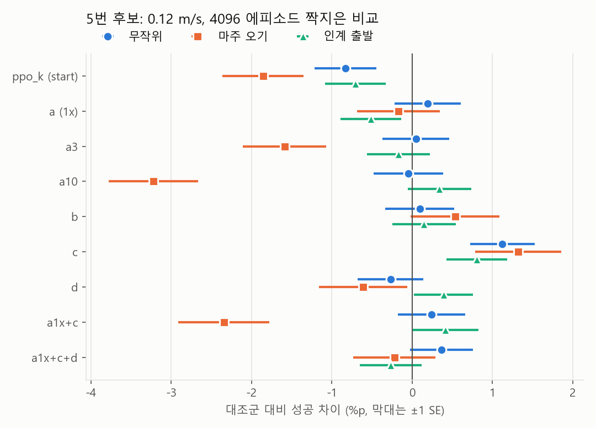
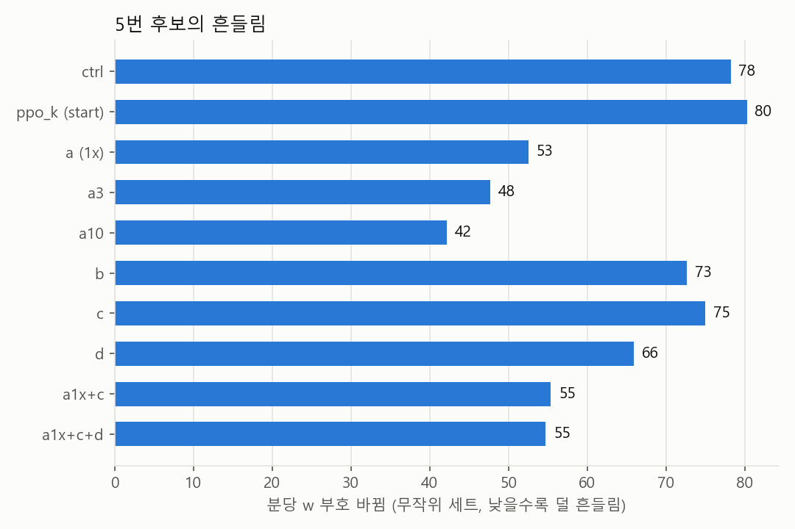
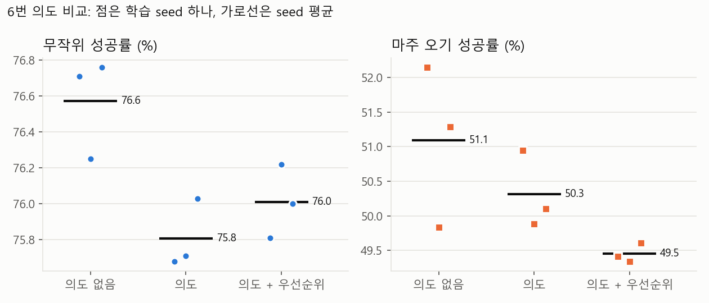
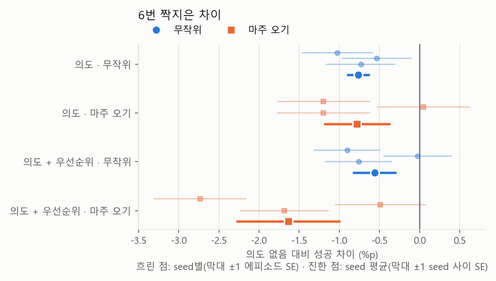
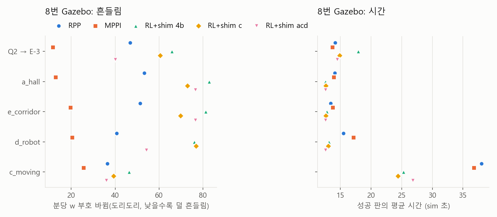

# 2026-11-23 아침 작업 보고

2026-11-22 밤부터 11-23 아침까지 한 일을 모았다. 표와 그래프는 `results/2026-11-23/`에 있고, 자세한 근거는 각 작업 기록에 있다.
`main` 병합은 사용자가 말한 것만 했다. 이 보고서 브랜치(`docs/report-2026-11-23`)의 병합은 사용자가 정한다.

## 한눈에

- **`main`에 넷을 합쳤다(사용자 지시).** nav2fleet 보관 목록 문서, 가짜 로봇 속도(fake-speed), 가짜 로봇 실물화(fake-realism),
  도착 시험의 속도 사본 수정이다. 지금 `main`은 9cbd413이다. 합친 `main`으로 네 시험 묶음을 다시 돌려 모두 통과했다(7절).
- **레시피 후보 가운데 성공을 잡음 밖으로 올린 것은 c(비대칭 actor-critic) 하나다.** 0.12 m/s에서 대조군 대비 무작위 +1.1,
  마주 오기 +1.3, 인계 출발 +0.8 %p다(짝지은 SE 0.4~0.5). 다만 판마다 학습 seed가 하나라서, seed 사이 퍼짐은 6번에서 처음 보았다(1.2절).
- **a(행동 변화 벌점)는 흔들림을 3분의 1 줄이고 성공은 그대로였다.** 분당 w 부호 바뀜이 78에서 53으로 줄었다. a+c 조합은 마주 오기에서
  −2.3 %p로 나빴고, a+c+d는 성공을 지키며(−0.2 %p) 흔들림 55였다.
- **승인한 B78 규칙대로라면 레시피는 a+c다.** a+c+d가 0.16 마주 오기 한 칸에서 d 단독보다 1.5 %p 나빠 떨어졌다. 그러나 a+c는 마주 오기
  −2.3 %p라서, 6번은 c 단독에서 시작했고(B79) Gazebo 8번은 c와 a+c+d를 비교했다. 6번에서 잰 학습 운(seed 하나씩인 두 판의 마주 오기 차이가
  약 1.7 %p 흔들림)을 보면, 마주 오기의 판 사이 차이는 대부분 운과 구별하기 어렵다. 최종 레시피는 사용자가 고른다(4절 1번).
- **피할 수 없는 실패는 실패의 3~10 %뿐이다(7번).** 서 있기만 해도 부딪히는 에피소드는 무작위 6.5 %, 마주 오기 2.3 %, 인계 출발 6.8 %다.
  나머지 90 % 넘는 실패는 정책이 더 잘하면 피할 수 있다.
- **의도 관측은 성공을 올리지 않았다(6번).** c 단독에서 seed 셋씩 500번 더 학습한 결과, 의도 없음 대비 의도는 무작위 −0.77 ± 0.14,
  마주 오기 −0.78 ± 0.42 %p이고, 의도 + 우선순위는 −0.56 ± 0.27, −1.64 ± 0.65 %p다(seed 평균 ± seed 사이 SE). 흔들림만 조금 줄었다.
- **Gazebo 다섯 컨트롤러(8번, 135판):** 움직이는 장애물이 없는 네 묶음에서는 RPP, MPPI, RL+shim 4b·c·acd 모두 다 성공했고 충돌이 없다.
  RL 셋이 가장 빠르고(통로 12.5~13.1 초) 가장 많이 흔들린다(54~83 /분). acd는 좁은 곳(Q2 → E-3, d_robot)에서 4b보다 덜 흔들리고
  이른 넘김이 적다(Q2 → E-3 판당 1.3 대 4.0). 사람·카트가 움직이는 c_moving은 다섯 모두 4/6~5/6이라 가를 수 없다.
  권고는 앞으로의 레시피는 a+c+d, 실물 정책은 판 수를 늘린 비교 전까지 지금의 4b다(4절 1번, 3번).
- **shim 회전 끝 문턱 0.39를 설정에 적었다(사용자 결정).** 나머지 shim 선택지와 실물 `nav2_params.yaml`에 대한 권고는 4절 2번에 있다.
- **ETA는 월요일 실물 기록을 기다린다.** E4, F2, F3, T1을 결정 목록에 "월요일 뒤"로 표시했다.
- **Isaac 학습 두 판 동시 실행은 하지 않는다.** GPU 사용률은 평균 38 %로 여유가 있지만, 4096 env 두 판이 10.24 GB 중 약 10.1 GB를 쓴다.
- **ROS 시나리오의 로봇 배율을 0.67~1.0으로 넓혔다(사용자 결정 3번, 브랜치만).** pode1 1.0, pode2 0.67, pode3 0.85다. 관제 시나리오
  10개가 모두 통과했고 기대값, 고장 시각, 시간 제한은 하나도 바꾸지 않았다. 관제 ETA 오차는 더 음수가 되었다(관제는 모든 로봇을 0.12로 본다).
- **관제가 작업 도크를 일찍 놓는 결함을 찾았다(`main`에도 있음, 고치지 않음).** 로봇이 W에서 M_E로 나갈 때, 몸이 아직 도크에서
  0.07~0.09 m인데 WORK_DOCK을 놓는다. 놓기 거리를 노드 좌표로 재는 지름길(9d43c78)과, M_E가 도크에서 딱 놓기 거리(0.135 m)에 있는 지도가
  겹친 탓이다. `main`에서 `test_fms_restart`를 18번 돌려 1번 났다. 고치는 방법은 O_OUT 인계 속도와 맞바꾸는 문제라 사용자가 정한다(4절 9번).

## 1. 레시피(5번)와 피할 수 없는 실패(7번)

기록: `feat/recipe-2026-11-22`의 `docs/worklog_recipe_2026-11-22.md` 5절, 표 `docs/recipe_2026-11-22/report_tables/`(같은 파일을
`results/2026-11-23/item5.csv`, `item7.csv`로 복사).

모든 평가는 세트마다 4096 env × 첫 에피소드, seed 7이다. 모든 판이 같은 에피소드를 보므로 env 번호로 짝지어 차이를 잰다.
괄호는 짝지은 SE(%p)다. "흔들림"은 분당 w 부호 바뀜이다(|w| < 0.02는 건너뜀, nav_bench 도리도리와 같은 셈).

### 1.1 후보별 세 세트 (0.12 m/s)

| 판 | 켠 것 | 무작위 성공 | 마주 오기 성공 | 인계 출발 성공 | 흔들림(무작위 / 마주 / 인계) |
|---|---|---|---|---|---|
| ctrl | ppo_k를 200번 더 학습 | 74.0 % | 48.9 % | 73.5 % | 78 / 81 / 85 |
| ppo_k(학습 전) | 시작 가중치 | 73.1 % (−0.8, 0.38) | 47.0 % (−1.9, 0.51) | 72.8 % (−0.7, 0.38) | 80 / 81 / 84 |
| a(1배) | 이전 행동 관측 + 행동 변화 벌점 | 74.2 % (+0.2, 0.41) | 48.7 % (−0.2, 0.52) | 73.0 % (−0.5, 0.38) | 53 / 54 / 56 |
| a3 | a의 벌점 3배 | 74.0 % (+0.0, 0.42) | 47.3 % (−1.6, 0.52) | 73.3 % (−0.2, 0.39) | 48 / 52 / 50 |
| a10 | a의 벌점 10배 | 73.9 % (−0.0, 0.43) | 45.6 % (−3.2, 0.56) | 73.9 % (+0.3, 0.40) | 42 / 45 / 43 |
| b | 라이다 이전 두 프레임 | 74.1 % (+0.1, 0.43) | 49.4 % (+0.5, 0.55) | 73.7 % (+0.1, 0.40) | 73 / 77 / 79 |
| c | 비대칭 actor-critic | 75.1 % (+1.1, 0.40) | 50.2 % (+1.3, 0.54) | 74.3 % (+0.8, 0.38) | 75 / 80 / 77 |
| d | 에피소드마다 최고 속도 0.08~0.16 | 73.7 % (−0.3, 0.41) | 48.2 % (−0.6, 0.55) | 73.9 % (+0.4, 0.37) | 66 / 67 / 67 |
| a+c | 조합 | 74.2 % (+0.2, 0.42) | 46.5 % (−2.3, 0.57) | 73.9 % (+0.4, 0.41) | 55 / 61 / 56 |
| a+c+d | 조합 | 74.3 % (+0.4, 0.39) | 48.6 % (−0.2, 0.51) | 73.2 % (−0.3, 0.39) | 55 / 57 / 60 |

다른 최고 속도에서의 성공(%, d가 노린 것):

| 판 | 0.08 무작위 | 0.08 마주 오기 | 0.16 무작위 | 0.16 마주 오기 |
|---|---|---|---|---|
| d 단독 | 70.5 | 47.2 | 74.0 | 48.1 |
| a+c+d | 71.3 | 47.5 | 73.9 | 46.6 |

### 1.2 고른 조합과 판정

- **B77**(결과를 보기 전에 정한 규칙): a(1배)와 c가 들었다. a는 무작위 흔들림이 33 % 줄고 두 세트 모두 −1.0 %p 안이었다. c는 두 세트 평균
  +1.2 %p였다. b와 d는 들지 않았다. a3, a10은 마주 오기를 더 잃었다.
- **B78**(사용자 승인): a+c+d는 (i) 0.12에서 a+c보다 어느 세트도 1.0 %p 넘게 나쁘지 않고, (ii) 0.08·0.16에서 d 단독보다 1.0 %p 넘게
  나쁘지 않을 때 고른다. (i)은 통과했다(+0.1 / +2.1 / −0.7). (ii)는 0.16 마주 오기에서 −1.5 %p(SE 0.52)로 떨어졌다. 그래서 규칙의 답은
  **a+c**다.
- **B79**(코디네이터): a+c는 마주 오기에서 대조군보다 −2.3 %p라 "성공을 지키며 흔들림 줄이기"에 맞지 않는다. 그래서 6번은 c 단독에서
  시작했고, 8번은 c와 a+c+d를 둘 다 돌렸다.
- **seed 퍼짐 주의:** 위의 SE는 평가 에피소드의 잡음만 담는다. 6번에서 같은 설정을 seed 셋으로 학습하니 무작위는
  76.3~76.8 %(표준편차 0.28 %p), 마주 오기는 49.8~52.2 %(표준편차 1.17 %p)였다. seed 하나씩인 두 판의 차이는 학습 운만으로 무작위 약 0.4 %p,
  마주 오기 약 1.7 %p 흔들린다. 그러면 c의 무작위 +1.1 %p는 운보다 크지만, 마주 오기의 차이(c +1.3, a+c −2.3)는 운과 구별하기 어렵다.
  B79가 근거로 든 "a+c의 마주 오기 −2.3 %p(약 4 SE)"의 SE에는 이 운이 빠져 있다.

### 1.3 서 있기 판(피할 수 없는 실패, 7번)

서 있는 로봇(행동 (0, 0))을 같은 에피소드에 돌려 정책 판과 env 번호로 짝지었다(`ceiling.py`).

| 세트 | 서 있어도 부딪힘 | 기다리기 상한 | 정책 | 정책 성공 | 실패 중 서 있어도 부딪히는 몫 | 그 에피소드에서 정책 성공 |
|---|---|---|---|---|---|---|
| 무작위 | 6.5 % | 93.6 % | ppo_k | 73.1 % | 8.8 % (97/1100) | 63 % |
| | | | c | 75.1 % | 9.0 % (92/1020) | 65 % |
| | | | a+c | 74.2 % | 9.7 % (102/1056) | 61 % |
| | | | a+c+d | 74.3 % | 8.4 % (88/1051) | 67 % |
| 마주 오기 | 2.3 % | 97.7 % | ppo_k | 47.0 % | 2.9 % (63/2171) | 34 % |
| | | | c | 50.2 % | 3.1 % (64/2041) | 33 % |
| | | | a+c | 46.5 % | 3.1 % (67/2191) | 29 % |
| | | | a+c+d | 48.6 % | 2.9 % (62/2104) | 35 % |
| 인계 출발 | 6.8 % | 93.2 % | ppo_k | 72.8 % | 9.7 % (108/1114) | 61 % |
| | | | c | 74.3 % | 9.9 % (104/1052) | 63 % |
| | | | a+c | 73.9 % | 9.6 % (102/1068) | 64 % |
| | | | a+c+d | 73.2 % | 10.0 % (110/1096) | 61 % |

- "기다리기 상한"은 서 있기만 하는 전략이 넘을 수 없는 상한이다. 절대 상한은 아니다. 서 있어도 부딪히는 에피소드에서도 정책은
  29~67 %를 피해서 성공한다.
- 마주 오기의 실패 2,000건 남짓 가운데 서 있어도 부딪히는 것은 60여 건이다. 마주 오기의 낮은 성공은 거의 모두 정책이 고칠 수 있는 실패다.

## 2. 의도 비교(6번)

기록: `feat/recipe-2026-11-22`의 `docs/worklog_recipe_2026-11-22.md` 5.5절, 표 `docs/recipe_2026-11-22/report_tables/item6*.csv`
(`results/2026-11-23/`에 복사).

c 단독 체크포인트(B79)에서 변형마다 seed 1~3을 500번(250번 × 2) 더 학습했다. 학습 조건은 같고 관측만 다르다.

| 변형 | 관측 |
|---|---|
| 의도 없음 | 기본 41칸(c 단독과 같은 입력) |
| 의도 | 가까운 다른 로봇 2대마다 있음 표시와 그 로봇 경로 위 0.2 m 간격의 앞 점 3개(우리 로봇 기준, 2.0 m에서 자름)를 더함 |
| 의도 + 우선순위 | 의도에 로봇마다 우선권 표시(1이면 그 로봇이 우리를 기다리지 않음)를 더함 |

평가는 5번과 같다(세트마다 4096 env × 첫 에피소드, seed 7). "0.10 m 안"은 에피소드 동안 다른 로봇 상자 표면까지의 최소 거리가
0.10 m 미만인 에피소드다. 로봇 충돌(중심에서 약 0.08 m 이하)은 모두 이 묶음에 들어가므로, 이 묶음의 성공률은 원래 낮고 변형끼리 견줄 때만 쓴다.

| 변형 | seed | 무작위 성공 | 충돌 / 시간 초과 | 0.10 m 안 성공(에피소드) | 흔들림 | 마주 오기 성공 | 충돌 / 시간 초과 | 0.10 m 안 성공(에피소드) | 흔들림 |
|---|---|---|---|---|---|---|---|---|---|
| 의도 없음 | 1 | 76.7 % | 22.1 / 1.2 % | 29.8 % (601) | 67 | 52.1 % | 46.6 / 1.2 % | 24.7 % (1861) | 69 |
| 의도 없음 | 2 | 76.2 % | 21.9 / 1.9 % | 28.6 % (584) | 70 | 49.8 % | 48.2 / 1.9 % | 21.9 % (1856) | 72 |
| 의도 없음 | 3 | 76.8 % | 20.9 / 2.3 % | 33.1 % (581) | 72 | 51.3 % | 44.9 / 3.8 % | 24.6 % (1878) | 82 |
| 의도 | 1 | 75.7 % | 22.9 / 1.4 % | 25.6 % (566) | 64 | 50.9 % | 47.7 / 1.3 % | 24.3 % (1870) | 69 |
| 의도 | 2 | 75.7 % | 23.2 / 1.1 % | 29.5 % (587) | 65 | 49.9 % | 48.5 / 1.6 % | 23.3 % (1911) | 72 |
| 의도 | 3 | 76.0 % | 23.2 / 0.8 % | 28.9 % (575) | 56 | 50.1 % | 48.9 / 1.0 % | 23.4 % (1913) | 58 |
| 의도 + 우선순위 | 1 | 75.8 % | 23.7 / 0.5 % | 30.3 % (584) | 59 | 49.4 % | 49.9 / 0.7 % | 20.9 % (1859) | 59 |
| 의도 + 우선순위 | 2 | 76.2 % | 23.0 / 0.8 % | 30.6 % (592) | 56 | 49.3 % | 49.9 / 0.8 % | 22.5 % (1901) | 58 |
| 의도 + 우선순위 | 3 | 76.0 % | 23.1 / 0.9 % | 30.8 % (594) | 64 | 49.6 % | 49.5 / 0.9 % | 23.6 % (1970) | 64 |

의도 없음 대비 짝지은 성공 차이(%p). seed 칸의 괄호는 에피소드 수준 SE(같은 seed의 의도 없음과 env 번호로 짝지음), 마지막 칸의 SE는
seed 세 차이의 표준편차 ÷ √3이다.

| 변형 | 세트 | seed 1 | seed 2 | seed 3 | seed 평균 ± seed 사이 SE |
|---|---|---|---|---|---|
| 의도 | 무작위 | -1.03 (0.44) | -0.54 (0.44) | -0.73 (0.43) | **-0.77 ± 0.14** |
| 의도 | 마주 오기 | -1.20 (0.58) | +0.05 (0.58) | -1.20 (0.58) | **-0.78 ± 0.41** |
| 의도 + 우선순위 | 무작위 | -0.90 (0.41) | -0.02 (0.42) | -0.76 (0.42) | **-0.56 ± 0.27** |
| 의도 + 우선순위 | 마주 오기 | -2.73 (0.57) | -0.49 (0.57) | -1.68 (0.55) | **-1.64 ± 0.65** |

- **의도 관측은 성공을 올리지 않았다.** 의도는 두 세트 모두 약 −0.8 %p, 의도 + 우선순위는 마주 오기에서 −1.6 %p(seed 사이 SE 0.65)다.
  무작위에서 의도의 손해는 seed 셋 모두 같은 쪽이다(−1.03, −0.54, −0.73).
- **흔들림은 조금 줄었다.** 무작위 분당 부호 바뀜이 의도 없음 67~72, 의도 56~65, 의도 + 우선순위 56~64다.
- **실패의 구성이 바뀌었다.** 의도를 넣은 판은 시간 초과가 줄고(무작위 1.2~2.3 % → 0.5~1.4 %) 충돌이 늘었다(20.9~22.1 % → 22.9~23.7 %).
  마주 오기도 같다. 덜 망설이고 더 부딪힌다고 읽힌다[추측].
- **0.10 m 안 에피소드의 성공률은 변형 사이에 뚜렷한 차이가 없다.** 무작위 25.6~33.1 %, 마주 오기 20.9~24.7 %이고, seed 사이 퍼짐과 겹친다.
- **해석의 한계:** 넓힌 체크포인트에서 새 의도 입력의 첫 층 가중치는 0에서 시작한다. 500번으로는 정책이 그 입력을 쓰는 법을 다 배우지
  못했을 수 있다.
- **학습 seed 퍼짐(의도 없음 세 판):** 무작위 76.3~76.8 %(표준편차 0.28 %p), 마주 오기 49.8~52.2 %(표준편차 1.17 %p). seed 하나씩인 두 판의
  차이는 이 퍼짐만으로도 무작위 약 0.4 %p, 마주 오기 약 1.7 %p 흔들린다. 이 판들은 c에서 500번 더 학습한 것이라 5번(ppo_k에서 200번)과
  조건이 다르지만, 크기를 가늠하는 데는 쓸 수 있다.

## 3. Gazebo 다섯 컨트롤러(8번)

기록: `feat/rl-shim-recipe-2026-11-22`의 `docs/worklog_rl_shim_recipe_2026-11-22.md` 2.3절(준비)과 2.4절(결과), 설정
`docs/rl_shim_recipe_2026-11-22/item8_overrides.yaml`. 5번에서 고른 후보 둘(c, a+c+d)을 실제 Nav2 controller로 Gazebo에서 돌려,
지금의 기본 정책과 기존 컨트롤러 둘과 견주었다. 비교 방법은 11-22 밤의 compare_012와 같다.

### 3.1 다섯 컨트롤러

| 이름 | 무엇인가 |
|---|---|
| RPP | Nav2 Regulated Pure Pursuit(`FollowPathGoal`). 경로 위 앞 점을 따라가며 장애물과 곡률에 따라 속도를 줄인다. 지금 실물에서 넓은 구역의 Nav2 goal을 모는 컨트롤러(`avoidance.yaml`) |
| MPPI | Nav2 MPPI(`FollowPathMPPI`). 속도 명령을 무작위로 많이 뽑아 앞날을 굴려 보고 비용이 낮은 쪽을 고른다. vx_max 0.12, time_steps 83. 시뮬에서는 RotationShim이 감싼다(오차 0.25 rad 넘으면 회전 시작, 끝 문턱은 적지 않아 Jazzy 기본값 0.3925) |
| RL+shim 4b | Nav2 RotationShim이 먼저 제자리에서 경로 방향으로 돌고(오차 0.785 rad 넘으면 시작, 0.39 rad 밑이면 넘김), 그다음 우리 RL 정책이 몬다. 정책은 지금 기본값 `store_arena_4b`(ppo_k, 관측 41칸) |
| RL+shim c | 같은 shim에 5번의 c 단독 정책(비대칭 actor-critic, 관측 41칸)을 넣은 것 |
| RL+shim acd | 같은 shim에 5번의 a+c+d 정책(이전 행동 관측 + 행동 변화 벌점 + 비대칭 actor-critic + 속도 상한 관측, 관측 44칸)을 넣은 것. 시뮬에서 속도 상한은 0.12 |

세 RL 판의 최고 속도는 모두 0.12 m/s이고, 세 shim 모두 `angular_disengage_threshold`를 0.39로 적었다(compare_012는 기본값 0.3925).

### 3.2 묶음

- **Q2 → E-3:** 진열대 사이 좁은 길. 칸마다 3판.
- **O_IN → M_E 네 시나리오:** 가운데 통로를 지난다. 칸마다 6판.
  - a_hall: 장애물 없음.
  - e_corridor: 통로 안 상자와 천천히 오가는 작은 카트(남쪽 틈 0.30 m).
  - d_robot: Pode 크기 대역이 통로 북쪽 줄로 마주 온다. 0.25 m 안에 들면 멈춰 기다린다.
  - c_moving: 사람 대역(남쪽 진열대 틈을 가로지름, 0.10 m/s)과 카트 대역(통로 북쪽 줄, 0.06 m/s).
- 성공은 Nav2 SUCCEEDED이면서 실제 위치가 goal에서 0.10 m 안일 때다. 충돌은 몸과 장애물 면의 실제 거리 0.005 m 이하, 한 판 상한 90 sim 초다.

### 3.3 결과

실행: 2026-11-23 09:06~10:53, 모든 시나리오가 정한 판 수를 다 돌았다(Q2 → E-3 15판, 본 비교 120판). 판 기록은
`results/2026-11-23/item8_legs_q2e3.csv`, `item8_legs_main.csv`(nav_bench `report.py`의 판별 표)이고, 아래 표와 그래프는 그 CSV에서
만들었다. "충돌 난 판"은 몸과 장애물이 0.005 m 안에 든 순간이 한 번이라도 있는 판이다. "도리도리 /분"은 각속도 부호 바뀜의 합 ÷ 시간의 합이다
(|w| 0.02 rad/s 밑은 건너뜀, Isaac의 분당 부호 바뀜과 같은 셈). "이른 넘김"은 오차 0.44 rad 넘게 남기고 끝난 shim 제자리 회전 수이고,
DEBUG 로그 없이 판 기록으로만 센 추정치다.

| 묶음 | 컨트롤러 | 성공 | 충돌 난 판 | 성공 판 시간 s | 도리도리 /분 | 몸 최소 거리 m | 이른 넘김(판당) |
|---|---|---|---|---|---|---|---|
| Q2 → E-3 | RPP | 3/3 | 0 | 14.1 | 47 | 0.065 | - |
| Q2 → E-3 | MPPI | 3/3 | 0 | 13.7 | 12 | 0.061 | - |
| Q2 → E-3 | RL+shim 4b | 3/3 | 0 | 17.9 | 66 | 0.061 | 12 (4.0) |
| Q2 → E-3 | RL+shim c | 3/3 | 0 | 14.9 | 60 | 0.062 | 7 (2.3) |
| Q2 → E-3 | RL+shim acd | 3/3 | 0 | 14.5 | 40 | 0.030 | 4 (1.3) |
| a_hall | RPP | 6/6 | 0 | 14.1 | 53 | 0.092 | - |
| a_hall | MPPI | 6/6 | 0 | 13.9 | 13 | 0.088 | - |
| a_hall | RL+shim 4b | 6/6 | 0 | 12.6 | 83 | 0.097 | 3 (0.5) |
| a_hall | RL+shim c | 6/6 | 0 | 12.6 | 73 | 0.097 | 1 (0.2) |
| a_hall | RL+shim acd | 6/6 | 0 | 12.5 | 77 | 0.095 | 2 (0.3) |
| e_corridor | RPP | 6/6 | 0 | 13.4 | 51 | 0.077 | - |
| e_corridor | MPPI | 6/6 | 0 | 13.8 | 20 | 0.067 | - |
| e_corridor | RL+shim 4b | 6/6 | 0 | 12.8 | 81 | 0.074 | 1 (0.2) |
| e_corridor | RL+shim c | 6/6 | 0 | 12.6 | 70 | 0.074 | 0 |
| e_corridor | RL+shim acd | 6/6 | 0 | 12.5 | 76 | 0.078 | 0 |
| d_robot | RPP | 6/6 | 0 | 15.5 | 41 | 0.044 | - |
| d_robot | MPPI | 6/6 | 0 | 17.1 | 20 | 0.038 | - |
| d_robot | RL+shim 4b | 6/6 | 0 | 13.1 | 76 | 0.031 | 3 (0.5) |
| d_robot | RL+shim c | 6/6 | 0 | 13.0 | 77 | 0.022 | 2 (0.3) |
| d_robot | RL+shim acd | 6/6 | 0 | 12.5 | 54 | 0.029 | 0 |
| c_moving | RPP | 5/6 | 3 | 38.0 | 36 | 0.000 | - |
| c_moving | MPPI | 5/6 | 4 | 36.8 | 26 | 0.000 | - |
| c_moving | RL+shim 4b | 5/6 | 2 | 25.3 | 46 | 0.000 | 10 (1.7) |
| c_moving | RL+shim c | 5/6 | 3 | 24.4 | 39 | 0.000 | 7 (1.2) |
| c_moving | RL+shim acd | 4/6 | 3 | 26.8 | 36 | 0.000 | 14 (2.3) |

- **움직이는 장애물이 없는 네 묶음에서는 다섯 모두 다 성공했고 충돌도 없다.** 통로 세 묶음(a_hall, e_corridor, d_robot)에서 RL 셋은
  12.5~13.1 초로 RPP(13.4~15.5)와 MPPI(13.8~17.1)보다 빠르다. 대신 도리도리가 54~83 /분으로 RPP(41~53)보다 많고, MPPI(13~20)가 가장 적다.
- **acd는 4b보다 덜 흔들리고 이른 넘김이 적다. 다만 좁은 곳에서만 차이가 뚜렷하다.** 도리도리는 Q2 → E-3에서 40 대 66, d_robot에서
  54 대 76이다. a_hall과 e_corridor에서는 76~77 대 81~83으로 차이가 작다. 이른 넘김은 Q2 → E-3에서 판당 1.3 대 4.0(c 2.3)이고, d_robot과
  e_corridor에서는 0이다.
- **c는 4b와 비슷하다.** 통로 세 묶음의 도리도리는 70~77 /분으로 4b(76~83)와 비슷하거나 조금 적고, Q2 → E-3 시간은 14.9 초로 4b(17.9)보다 짧다.
- **c_moving에서는 다섯 모두 실패가 있고, 판마다 차이를 가를 수 없다.** 성공은 RPP·MPPI·4b·c가 5/6, acd가 4/6이다. 충돌 난 판은
  2~4판이고, 실패 6판은 모두 충돌이 있었던 판이다. 충돌 순간을 모두 더하면 RPP 12, MPPI 8, 4b 2, c 14, acd 11번인데, 한 판에서 여러 번
  닿은 것이 커서(c의 실패 판 하나가 11번) 판 수로 보는 편이 낫다. 사람·카트 대역은 피하지 않고 지나가므로, 충돌에는 대역이 서 있는 로봇에 닿은 경우도
  들어 있다[추측]. 실패 6판 가운데 넷은 Nav2가 ABORTED로 끝냈다. 둘은 SUCCEEDED였지만 실제 위치가 goal에서 4b 1판은 1.26 m,
  acd 1판은 0.57 m 떨어져 있었다. 밀려서 AMCL 위치가 틀어진 것으로 보인다[추측]. 시간 초과(90 초)는 없다. 6판씩이라 4/6과 5/6은 구별되지 않는다.
- **acd는 c_moving에서 이른 넘김이 판당 2.3번으로 가장 많다.** shim이 출발과 재계획 때 돈 횟수도 30번으로 가장 많다(4b 18, c 22).
  사람·카트를 피하느라 경로가 자주 바뀌어 shim이 자주 끼어든 것으로 보인다[추측].
- **Q2 → E-3의 acd 1판은 몸과 벽 사이가 0.030 m까지 좁아졌다.** 다른 판과 컨트롤러는 0.061~0.065 m다. 충돌은 아니지만 3판뿐이라 우연인지
  알 수 없다.
- **Isaac과 Gazebo의 흔들림 개선 폭이 다르다.** Isaac에서 a+c+d는 대조군보다 분당 부호 바뀜이 약 30 % 적었다(55 대 78). Gazebo에서는
  4b보다 6~39 % 적다. Gazebo의 RL 판에는 shim 회전과 끝 회전도 섞여 있어 두 숫자를 그대로 견줄 수는 없다.

## 3.5 가짜 로봇 배율 넓히기

기록: `feat/fake-scale-widen-2026-11-23`의 `docs/worklog_fake_scale_widen_2026-11-23.md`.

- 규칙: 시나리오 12개 모두 pode1 1.0, pode2 0.67, pode3 0.85(두 대짜리 `real_two_orders`는 1.0, 0.67). pode2는 전에도 느린 로봇(0.9)이라
  시나리오 주석의 "누가 먼저 닿는지"가 그대로다. 일부러 느리게 둔 시험 대역 `fms_restart.yaml`(0.1667)은 그대로 두었다.
- 다른 후보: 시나리오마다 느린 로봇 돌리기, 이름·씨드로 뽑기, 두 대만 넓히기. 고장 시각이 정해진 시나리오의 뜻을 지키려고 고정 규칙을 골랐다.

| 시나리오 | 판정 | 끝 시각(시뮬 s) | 여유(시뮬 s) | ETA 절대 오차 평균(s) | ETA 부호 있는 평균(s) |
|---|---|---|---|---|---|
| basic_orders | 통과 → 통과 | 233.9 → 253.8 | 666 → 646 | 2.58 → 4.17 | −2.54 → −4.15 |
| order_burst | 통과 → 통과 | 353.8 → 392.2 | 846 → 808 | 2.77 → 4.83 | −2.75 → −4.82 |
| shared_lane_failure | 통과 → 통과 | 270.8 → 261.8 | 629 → 638 | 2.56 → 3.87 | −2.52 → −3.81 |
| stock_shortage | 통과 → 통과 | 181.2 → 193.0 | 719 → 707 | 2.88 → 3.62 | −2.84 → −3.60 |
| stuck_robot | 통과 → 통과 | 400 → 400(일부러 시간 초과) | - | 2.42 → 4.85 | −2.41 → −4.84 |
| operator_recovery | 통과 → 통과 | 324.5 → 346.0 | 576 → 554 | 0.51 → 1.11 | −0.32 → −1.02 |
| blocked_lane | 통과 → 통과 | 263.6 → 269.4 | 636 → 631 | 1.76 → 3.47 | −1.71 → −3.44 |
| auto_isolation | 통과 → 통과 | 253.2 → 263.5 | 647 → 637 | 1.59 → 3.07 | −1.47 → −3.03 |
| reinstate | 통과 → 통과 | 359.4 → 372.9 | 541 → 527 | 2.10 → 2.70 | −2.04 → −2.66 |
| arm_fault | 통과 → 통과 | 133.1 → 140.3 | 767 → 760 | 1.52 → 1.73 | −1.46 → −1.69 |

- 고장을 맞는 로봇과 주문은 전과 같았고, 고장 시점만 2~10 s 늦어졌다. 가장 작은 여유는 527 시뮬 s다.
- 시험 묶음(배율을 바꾼 뒤): pode_nav_config 111 passed, fleet_core 1230 passed 7 xfailed, fake_robots 1156 passed 1 skipped
  30 xfailed, fleet_manager 2 failed 135 passed. 실패한 둘과 `main`에서 실패한 하나는 따로 돌리면 통과한다(5절).

## 4. 사용자가 정할 것

1. **최종 레시피.** 승인한 B78 규칙의 답은 a+c다. 그러나 a+c는 마주 오기에서 −2.3 %p다. c 단독은 성공이 가장 높고, a+c+d는 성공을 지키며
   흔들림이 가장 적다. 8번 결과(3절)와 6번의 seed 퍼짐(2절)을 보고 고른다.
   권고: **a+c+d**. Isaac에서 성공은 대조군과 운의 폭 안에서 같고 흔들림이 약 30 % 적다. Gazebo에서도 좁은 곳의 흔들림과 이른 넘김이
   셋 가운데 가장 적다. 속도 상한을 관측하므로 실물 속도가 0.12와 달라도 맞출 수 있다. 대가는 셋이다. c_moving 4/6(6판이라 5/6과 구별
   안 됨)이고, 정책 형식 3이라 `feat/rl-shim-recipe-2026-11-22`의 플러그인이 `main`에 들어가야 한다. 또 B78 규칙의 답(a+c)과 다르다.
   성공률을 가장 중시한다면 c 단독이 대안이다(Isaac 무작위 +1.1 %p, 형식 2라 지금 플러그인으로 바로 돈다).
   이것은 앞으로 학습할 레시피의 권고다. 실물에 올릴 정책을 지금 바꾸자는 뜻은 아니다(3번).
2. **shim 선택지와 실물 `nav2_params.yaml`의 RL 설정.** 8번 결과를 본 뒤 정하기로 했다. 선택지는 `feat/rl-shim-recipe-2026-11-22`의
   작업 기록 1.4절 표에 있다. 8번에서 이른 넘김은 정책을 바꾸는 것만으로 줄었다(Q2 → E-3 판당 4b 4.0, c 2.3, acd 1.3).
   그래도 c_moving에서는 acd도 판당 2.3번이다. 권고: 1번 정책으로 실물 시험을 먼저 하고, 실물에서도 벽 옆 이른 넘김이 보이면
   `rotate_to_heading_once`나 `simulate_ahead_time`을 다음 Gazebo 비교에 올린다. 시뮬의 MPPI를 감싼 shim(`nav2_params.yaml`의
   `FollowPathMPPI`)은 `angular_disengage_threshold`를 적지 않아 기본값 0.3925 그대로다. 8번의 MPPI도 그 값으로 돌았다.
3. **배포할 정책과 onnx 커밋.** c와 a+c+d의 onnx는 배포 정책이 아니라서 커밋하지 않았다. 1번이 정해지면 그 정책만 커밋한다.
   권고: 실물 정책은 당분간 지금의 4b로 둔다. Gazebo에서 acd가 나은 곳은 Q2 → E-3(3판)뿐이고, c_moving에서는 acd 4/6, 4b 5/6이다(충돌 난 판
   acd 3, 4b 2). 바꾸려면 먼저 Q2 → E-3과 c_moving을 칸마다 20판쯤으로 늘려 acd와 4b를 다시 비교한다(약 1시간 30분, Gazebo 한 판).
   Gazebo 트랙도 같은 권고를 냈다.
   그 전까지 `feat/rl-shim-recipe-2026-11-22`를 새로 받으면 c와 acd의 onnx가 없어서, 그 둘을 쓰는 parity 시험이 실패한다.
4. **의도 관측을 계속할지.** 6번에서 의도와 의도 + 우선순위 모두 성공을 올리지 못했다(2절). 권고: 레시피에는 넣지 않고, 실물 정책의
   입력은 의도 없는 41칸으로 둔다. 다시 시도한다면 관측 형태(앞 점 개수, 거리)나 보상을 바꾼 새 실험이 필요하다.
5. **로봇 배율 넓히기 브랜치의 병합과 관제의 로봇별 속도.** `feat/fake-scale-widen-2026-11-23`을 `main`에 합칠지 정한다. 합치면 관제
   ETA 오차가 느린 로봇만큼 더 음수로 나온다. 관제가 로봇마다 속도를 알게 할지는 ETA 결정(이 절 8번)과 함께 정하는 것이 맞다고 본다.
6. **고정 15 s 대기 시험 넷(결정 대기 그대로).** 시험 전체가 14.5~14.9 s 걸린다. 계산한 대기로 바꿀지 정한다.
7. **pode_fsm `pass_m` 사본 시험.** pode_fsm의 `OrderParams.pass_m = 0.15`는 관제 `nav_pass_m`의 사본인데, 둘을 묶는 시험이 없다.
8. **ETA(E1~E4, F2, F3, T1).** 월요일 실물 측정과 두 대 시험의 관제 기록이 나온 뒤 정한다. 도구와 명령은 `tools/real_pode/README.md`에 있다.
9. **작업 도크를 일찍 놓는 관제 결함을 어떻게 고칠지.** 기록: `diag/dock-release-2026-11-23`의 `docs/worklog_dock_release_2026-11-23.md`.
   - 원인: `pc/fleet_core/fleet_core/traffic/zone/progress.py`의 `_release_behind`는 보고 위치가 지금 노드에서 0.05 m 안이면 놓기 거리를
     노드 좌표로 잰다. M_E(1.645, 0.55)는 WORK_DOCK(x 1.78부터)에서 정확히 놓기 거리 0.135 m다. 그래서 M_E에서 0.05 m 안의 보고는
     몸이 도크에서 0.085 m여도 "벗어남"으로 센다. 가짜 로봇이 nav_goal 끝 0.15 m 앞에서 넘어가면 관제의 지금 노드는 이미 M_E다.
   - 같은 모양의 노드: Q1(WORK_DOCK에서 0.135), O_IN(OUT_DOCK에서 0.140), O_OUT(0.145). 이 지름길을 막는 시험
     (`test_layout_v7.py`의 `test_v7_pass_node_shortcut_cannot_release_a_dock_early`)은 PASS 노드만 보아서 M_E(fork)를 놓친다.
   - 가장 작은 수정: 노드 좌표로 잴 때 "노드에서 도크까지 − 0.05 ≥ 놓기 거리"인 노드에서만 지름길을 쓴다. 대가: O_OUT에서도 지름길이
     꺼져 9d43c78이 얻은 O_OUT 인계 단축(8.5 s → 약 4 s)이 사라진다. O_OUT을 도크에서 0.185 m 이상으로 옮기면 지킬 수 있다.
     M_E는 남쪽 진열대 끝에 묶여 서쪽으로 옮길 수 없다.
   - 잡을 시험(아직 넣지 않음): 위 시험을 도크에서 나오는 모든 edge 끝 노드로 넓히기(지금 M_E에서 실패), M_E 0.045 m 앞에서 WORK_DOCK을
     쥐고 있어야 한다는 Harness 시험.

## 5. 알아야 할 포인트

- **5번의 판은 모두 학습 seed 하나다.** 짝지은 SE는 평가 잡음만 담는다. 6번의 seed 셋이 학습 운의 크기를 처음 보여 준다(2절).
- **0.10 m 안 에피소드에는 로봇 충돌이 모두 들어 있다.** 거리는 우리 로봇 중심에서 다른 로봇 상자 표면까지의 에피소드 최솟값이고,
  약 0.08 m 이하(우리 발자국 0.0745 m + 0.005 m)면 로봇 충돌로 센다. 그래서 이 묶음의 성공률은 원래 낮다. 변형끼리 견줄 때만 쓴다.
- **8번 shim 설정은 compare_012와 0.0025 rad 다르다.** 회전 끝 문턱을 기본값 0.3925 대신 0.39로 적었다.
- **6번 취소 소동:** 두 판 동시 시험을 취소했지만, 시험 셸이 이미 대기 중이라 00:19에 잠금을 잡고 64 env 시험을 1분 안 되게 돌렸다.
  Isaac 트랙이 그 프로세스를 끝내고 잠금을 풀었다. 6번 큐는 기다리기만 했고 판을 잃지 않았다.
- **fleet_manager 전체 묶음의 간헐 실패.** 오늘 전체 묶음에서 세 시험이 한 번씩 실패했다. 하트비트 주기 시험과 서버 채우기 취소 시험은
  따로 돌리면 `main`과 배율 브랜치에서 5/5 통과한다. Isaac 학습과 겹친 부하 탓으로 본다[추측]. `test_fms_restart`의 실패 하나는 위의
  도크 결함이고, 다른 하나("goal not ABORTED in 10 s")는 조사하지 않았다.
- **가짜 로봇 실물화 뒤 관제 ETA 오차는 Gazebo보다 크게 나온다.** 끝 회전은 Gazebo에 맞았지만, 다음 조각이 nav_goal인 표본이 대부분이라
  전체 평균은 −2.30 s다(Gazebo −0.41 s). 원인 후보 E4(넘어가기 보정)는 월요일 뒤에 정한다.

## 6. 브랜치와 병합

| 브랜치 | 끝 | 상태 |
|---|---|---|
| `docs/archive-nav2fleet-2026-11-22` | 93d9832 | `main`에 합침(fast-forward) |
| `feat/fake-speed-2026-11-22` | 11b23ae | `main`에 합침(694770e) |
| `feat/fake-realism-2026-11-22` | 98df7e9 | `main`에 합침(386dfcf) |
| `fix/world-nav-goal-speed-source-2026-11-23` | 894ee14 | `main`에 합침(9cbd413) |
| `feat/rl-shim-recipe-2026-11-22` | eca8900 | push만. shim 0.39, 형식 3 플러그인, 8번 결과(`item8_results.*`, 작업 기록 2.4절) |
| `feat/recipe-2026-11-22` | 9c58d67 | push만. 5·6·7번, 보고 표와 그 스크립트. 후보 onnx 셋은 커밋하지 않음 |
| `feat/eta-cause-2026-11-22` | b905ac4 | push만. ETA 결정 목록 |
| `feat/fake-scale-widen-2026-11-23` | e328600 | push만. 배율 넓히기와 작업 기록 |
| `diag/dock-release-2026-11-23` | 276e687 | push만. 도크 일찍 놓기 진단 기록(코드 변경 없음) |
| `docs/report-2026-11-23` | 이 문서 | push만 |

## 7. 시험

합친 `main` 386dfcf을 WSL에서 새로 빌드해 돌렸다(9cbd413은 시험 파일 하나와 작업 기록만 더했다).

| 묶음 | 결과 |
|---|---|
| 빌드(10개 패키지) | 성공 |
| pode_nav_config | 111 passed |
| fake_robots | 1156 passed, 1 skipped, 30 xfailed |
| fleet_manager | 137 passed |
| fleet_core | 1230 passed, 7 xfailed |

`fix/world-nav-goal-speed-source`: 출처를 0.10으로 바꾸면 옛 도착 시험은 실패하고 고친 시험은 통과했다. 그 파일 10개 시험은 0.12에서 통과한다.
`feat/rl-shim-recipe`: `test_sim_nav_params.py` 43 passed(0.39 단언을 먼저 넣어 실패를 본 뒤 값을 넣음).

## 8. 느슨해진 기준

오늘 `main`에 들어간 것 가운데 기준이 느슨해진 곳(자세히는 `docs/worklog_fake_speed_2026-11-22.md` 6절, 9.4절):

- pose_jumps c 씨드 2(order 끔) 세 칸을 strict xfail로 바꿨다. 이미 열린 문제(I3_OUTSIDE_HELD)가 이 판에서 났다. 관제가 고쳐지면 XPASS로 실패한다.
- 복구 시험 둘의 BLOCKED 대기를 실제 초로 늘렸다(20 → 21.9 s, 10 → 21.9 s). 물체 시각이 3 s 늦어졌고, 대기를 한 식으로 계산하게 바뀌었다.
- 이동 대기를 "거리 ÷ (출처 속도 × 배율) × 1.5 + 2 s"로 계산하게 바꿨다(사용자 결정). 0.12에서 이동을 끝낼 수 있는 시간으로 늘었다.
- `feat/recipe-2026-11-22`(push만): 체크포인트 넓히기는 float64에서만 비트까지 같음을 확인하고, float32에서는 `allclose(1e-5)`로 본다.
  넓은 행렬곱이 더하는 순서를 바꿔 마지막 비트가 달라지기 때문이다.
- fake-realism, shim 0.39, 도착 시험 수정, 배율 넓히기에는 느슨해진 기준이 없다.

## 9. 검수(Codex)

| 대상 | 결과 | 처리 |
|---|---|---|
| shim 0.39(88b4639) | [확정] 1: 작업 기록이 8번을 compare_012와 같은 조건이라고 적음 | 고침(c4e605d) |
| 합친 `main` 93d9832..386dfcf | [확정] 5 | 1건 고침(도착 시험의 0.12 사본, 9cbd413). 4건은 이유를 적고 두었다(`worklog_fake_speed` 9.9절) |
| 도착 시험 수정(894ee14) | 결함 없음 | - |
| 배율 넓히기 9cbd413..35a30cc | [확정] 2: 선택지 ㄷ을 재현되지 않는 것처럼 적음, 환산 벽시계를 잰 값처럼 씀 | 둘 다 고치고, `main`의 ETA가 바뀐 원인을 관제 변경으로 잘못 적은 것도 고침(e328600) |
| 레시피 작업 기록 결과 | 결함 없음 | - |
| 보고 표 스크립트와 README | [확정] 2: 평가가 빠지면 빈칸으로 남음, README의 발자국 숫자 | 둘 다 고침(9c58d67). CSV는 다시 만들어도 바이트까지 같다 |
| 도크 일찍 놓기 진단(판단) | 결함 동의. 표본이 어느 분기로 세였는지는 관제가 기록하지 않아 확인 못 함 | 기록에 적음 |
| 8번 결과 스크립트와 작업 기록(277cf41) | [확정] 2: 스크립트를 다시 돌리면 .md의 손으로 쓴 절이 지워짐, 최소 거리 문장이 c_moving의 0을 빠뜨림 | 둘 다 고침(eca8900). 다시 돌려도 같은 파일이 나온다 |
