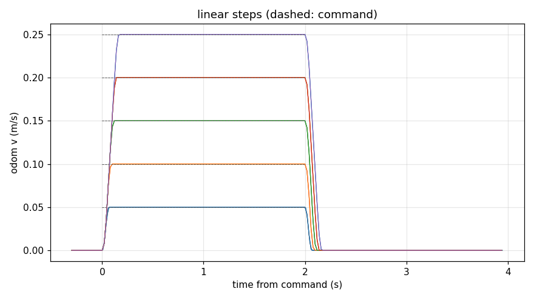
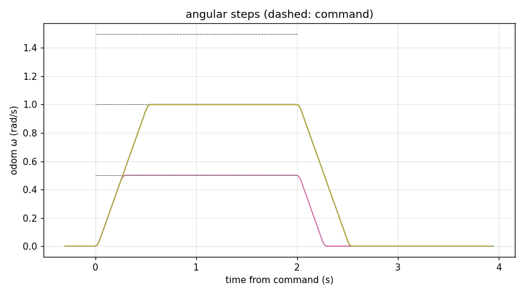
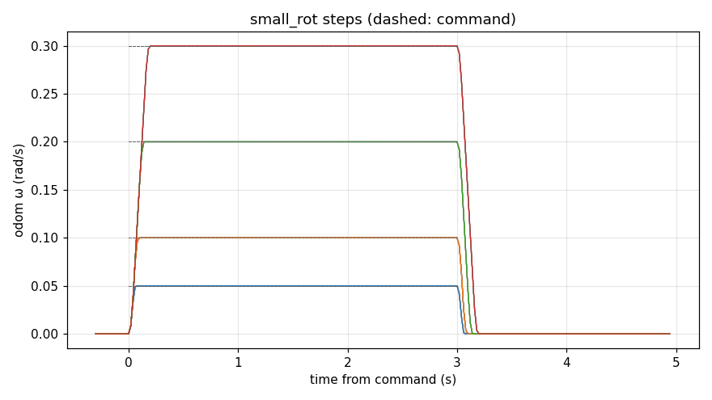
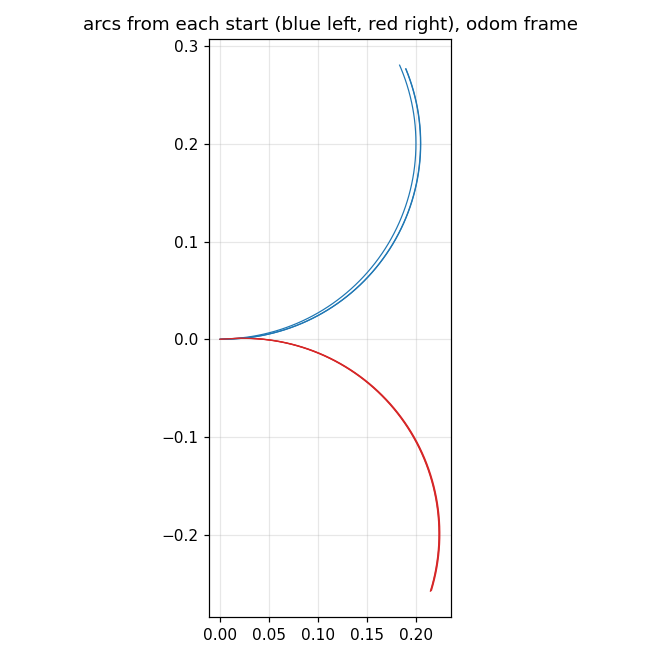

# Gazebo Pode cmd_vel 계단 응답 (2026-11-21)

입력: step_angular.csv, step_arc.csv, step_linear.csv, step_small_rot.csv

## 계단 응답

| set | label | 반복 | 지연 s | 상승 s | 정상 비 | 최대 가속 | 최대 감속 |
|---|---|---|---|---|---|---|---|
| angular | w0.50 | 1 | 0.047 | 0.200 | 1.000 | 2.00 | 2.00 |
| linear | v0.05 | 1 | 0.013 | 0.044 | 1.000 | 1.00 | 0.70 |
| angular | w1.00 | 1 | 0.072 | 0.400 | 1.000 | 2.00 | 2.00 |
| linear | v0.10 | 1 | 0.021 | 0.053 | 1.000 | 1.30 | 1.30 |
| angular | w1.50 | 1 | 0.097 | 미도달 | 0.667 | 2.00 | 2.00 |
| linear | v0.15 | 1 | 0.025 | 0.069 | 1.000 | 1.75 | 1.75 |
| linear | v0.20 | 1 | 0.029 | 0.086 | 1.000 | 1.92 | 1.92 |
| linear | v0.25 | 1 | 0.032 | 0.104 | 1.000 | 2.00 | 2.00 |
| angular | w0.50 | 2 | 0.047 | 0.200 | 1.000 | 2.00 | 2.00 |
| angular | w1.00 | 2 | 0.072 | 0.400 | 1.000 | 2.00 | 2.00 |
| angular | w1.50 | 2 | 0.097 | 미도달 | 0.667 | 2.00 | 2.00 |
| linear | v0.05 | 2 | 0.013 | 0.043 | 1.000 | 0.85 | 0.70 |
| linear | v0.10 | 2 | 0.021 | 0.053 | 1.000 | 1.30 | 1.30 |
| linear | v0.15 | 2 | 0.025 | 0.069 | 1.000 | 1.75 | 1.75 |
| linear | v0.20 | 2 | 0.029 | 0.086 | 1.000 | 1.92 | 1.92 |
| linear | v0.25 | 2 | 0.032 | 0.104 | 1.000 | 2.00 | 2.00 |
| angular | w0.50 | 3 | 0.047 | 0.200 | 1.000 | 2.00 | 2.00 |
| angular | w1.00 | 3 | 0.072 | 0.400 | 1.000 | 2.00 | 2.00 |
| angular | w1.50 | 3 | 0.097 | 미도달 | 0.667 | 2.00 | 2.00 |
| linear | v0.05 | 3 | 0.013 | 0.043 | 1.000 | 0.85 | 0.70 |
| linear | v0.10 | 3 | 0.021 | 0.053 | 1.000 | 1.30 | 1.30 |
| linear | v0.15 | 3 | 0.025 | 0.069 | 1.000 | 1.75 | 1.75 |
| linear | v0.20 | 3 | 0.029 | 0.086 | 1.000 | 1.92 | 1.92 |
| linear | v0.25 | 3 | 0.032 | 0.104 | 1.000 | 2.00 | 2.00 |

평균(반복 묶음):

| set | label | 지연 s | 상승 s | 정상 비 | 최대 가속 | 최대 감속 |
|---|---|---|---|---|---|---|
| angular | w0.50 | 0.047 | 0.200 | 1.000 | 2.00 | 2.00 |
| linear | v0.05 | 0.013 | 0.043 | 1.000 | 0.90 | 0.70 |
| angular | w1.00 | 0.072 | 0.400 | 1.000 | 2.00 | 2.00 |
| linear | v0.10 | 0.021 | 0.053 | 1.000 | 1.30 | 1.30 |
| angular | w1.50 | 0.097 | 미도달 | 0.667 | 2.00 | 2.00 |
| linear | v0.15 | 0.025 | 0.069 | 1.000 | 1.75 | 1.75 |
| linear | v0.20 | 0.029 | 0.086 | 1.000 | 1.92 | 1.92 |
| linear | v0.25 | 0.032 | 0.104 | 1.000 | 2.00 | 2.00 |

가속 단위: linear는 m/s², angular는 rad/s². 지연은 명령에서 odom이 목표의 10%에 닿기까지, 상승은 10%에서 90%까지. 둘 다 명령을 내는 동안에서만 찾고, 그 안에 닿지 못하면 미도달(평균은 한 번이라도 못 닿으면 미도달).

## 작은 회전(데드밴드)

| v | ω 명령 | 평균 ω 비 |
|---|---|---|
| 0.00 | 0.05 | 1.000 |
| 0.00 | 0.10 | 1.000 |
| 0.00 | 0.20 | 1.000 |
| 0.00 | 0.30 | 1.000 |
| 0.12 | 0.05 | 1.000 |
| 0.12 | 0.10 | 1.000 |
| 0.12 | 0.20 | 1.000 |
| 0.12 | 0.30 | 1.000 |

- v=0.00: 반응하는 가장 작은 ω = 0.05 rad/s (평균 비 ≥ 0.5)
- v=0.12: 반응하는 가장 작은 ω = 0.05 rad/s (평균 비 ≥ 0.5)

## 원호

| label | 반복 | R 명령 | R 궤적 맞춤 | R v÷ω(odom) | 맞춤/명령 |
|---|---|---|---|---|---|
| arc_left_v0.10_w0.50 | 1 | 0.200 | 0.200 | 0.200 | 1.000 |
| arc_right_v0.10_w0.50 | 1 | 0.200 | 0.200 | 0.200 | 1.000 |
| arc_left_v0.10_w0.50 | 2 | 0.200 | 0.200 | 0.200 | 1.000 |
| arc_right_v0.10_w0.50 | 2 | 0.200 | 0.200 | 0.200 | 1.000 |
| arc_left_v0.10_w0.50 | 3 | 0.200 | 0.200 | 0.200 | 1.000 |
| arc_right_v0.10_w0.50 | 3 | 0.200 | 0.200 | 0.200 | 1.000 |

- 왼쪽 평균 R 0.200 m, 오른쪽 0.200 m, 차이 -0.000 m (-0.0%)

