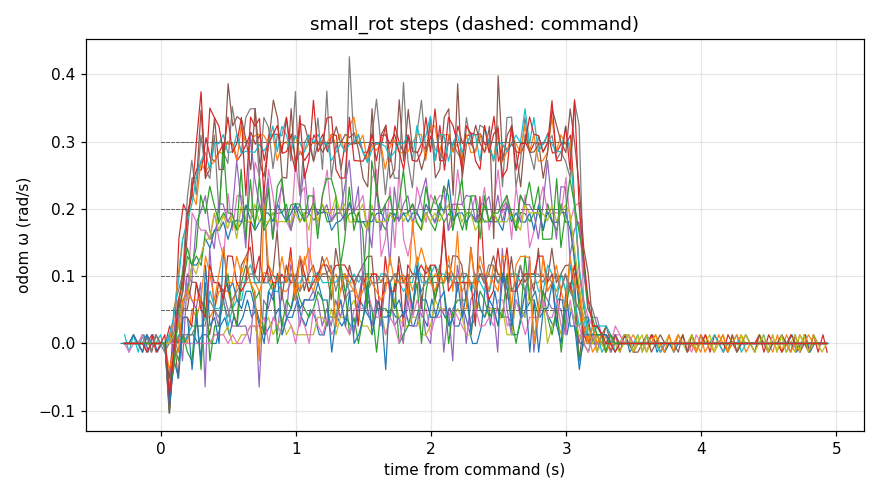
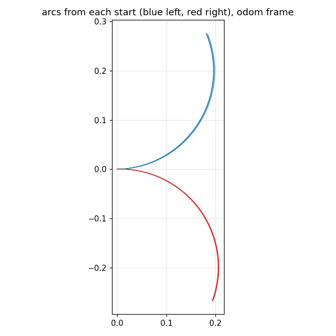

# cmd_vel 계단 응답

입력: step_small_rot_1126.csv, step_arc_1126.csv

## 작은 회전(데드밴드)

| v | ω 명령 | 평균 ω 비 |
|---|---|---|
| 0.00 | 0.05 | 0.793 |
| 0.00 | 0.10 | 0.951 |
| 0.00 | 0.20 | 0.940 |
| 0.00 | 0.30 | 0.988 |
| 0.12 | 0.05 | 1.027 |
| 0.12 | 0.10 | 0.984 |
| 0.12 | 0.20 | 0.999 |
| 0.12 | 0.30 | 0.980 |

- v=0.00: 반응하는 가장 작은 ω = 0.05 rad/s (평균 비 ≥ 0.5)
- v=0.12: 반응하는 가장 작은 ω = 0.05 rad/s (평균 비 ≥ 0.5)

## 원호

| label | 반복 | R 명령 | R 궤적 맞춤 | R v÷ω(odom) | 맞춤/명령 |
|---|---|---|---|---|---|
| arc_left_v0.10_w0.50 | 1 | 0.200 | 0.201 | 0.200 | 1.003 |
| arc_right_v0.10_w0.50 | 1 | 0.200 | 0.200 | 0.200 | 0.998 |
| arc_left_v0.10_w0.50 | 2 | 0.200 | 0.201 | 0.201 | 1.004 |
| arc_right_v0.10_w0.50 | 2 | 0.200 | 0.200 | 0.200 | 0.998 |
| arc_left_v0.10_w0.50 | 3 | 0.200 | 0.201 | 0.201 | 1.003 |
| arc_right_v0.10_w0.50 | 3 | 0.200 | 0.199 | 0.200 | 0.997 |

- 왼쪽 평균 R 0.201 m, 오른쪽 0.200 m, 차이 +0.001 m (+0.6%)

